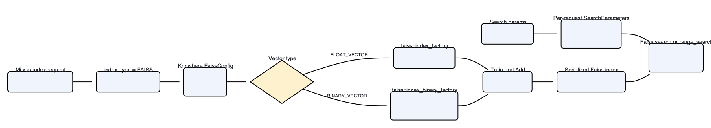

# FAISS

The `FAISS` index type is an expert-level passthrough available in Milvus 3.0.0 and later. It lets you supply a [Faiss index-factory string](https://github.com/facebookresearch/faiss/wiki/The-index-factory) instead of selecting a fixed Milvus index type.

Use `FAISS` when you already have a tested Faiss recipe and need direct control over its composition. For common recipes with a dedicated Milvus index type, prefer the dedicated type because it has a stable, documented parameter contract.

<div class="alert note">

A factory string accepted by upstream Faiss is not automatically supported by Milvus. Compatibility depends on the vector field type, metric, dimension, Faiss modules compiled into the Milvus image, and whether the resulting index supports the operations that Milvus requires.

</div>

## Limits

- `FAISS` supports `FLOAT_VECTOR` and `BINARY_VECTOR` fields. It does not support `FLOAT16_VECTOR`, `BFLOAT16_VECTOR`, `INT8_VECTOR`, or `SPARSE_FLOAT_VECTOR` fields.

- The generic `FAISS` adapter runs on CPU. It is not a Faiss GPU index type.

- `SVSVamana` factory strings work only in Milvus builds with SVS enabled. `LVQ` and `LeanVec` storage also requires an Intel CPU. See [Build and search an SVS Vamana index](#Build-and-search-an-SVS-Vamana-index).

- The `faiss_index_name` build parameter is required. Milvus passes its value to Faiss without converting the recipe to a dedicated Milvus index type.

- Build and search parameters are factory-specific. A parameter supported by one factory can be rejected by another.

- Scalar filtering requires the underlying Faiss index to support an ID selector. Milvus 3.0.0 tests cover filtered search with the float factories `Flat`, `IVF64,Flat`, and `HNSW16,Flat`. Do not assume that every factory supports filters or that binary `FAISS` indexes support scalar filtering.

- Search iterators are not supported.

- The adapter does not provide raw-vector retrieval.

- Range-search support depends on the factory. Float `Flat` has release coverage. Do not use range search with binary `FAISS` indexes.

- A factory can build successfully but still reject some Milvus search operations. For example, standalone `PQ8x4` rejects the selector used by scalar-filtered search. Validate unfiltered use separately.

- In Milvus 3.0.0, validate `COSINE` scores and range-search thresholds after an index reload. Knowhere v3.0.6 does not restore the `FAISS` adapter's cosine-normalization state during deserialization.

## How it works



For index building, Milvus forwards `faiss_index_name`, the vector field type, the metric, and other build parameters to the Knowhere FAISS adapter. The adapter calls `faiss::index_factory()` for `FLOAT_VECTOR` fields or `faiss::index_binary_factory()` for `BINARY_VECTOR` fields. The resulting object is a native Faiss index managed through the normal Milvus index lifecycle.

For search, the adapter converts the supplied factory-specific parameters into the matching Faiss `SearchParameters` object. For supported float factories, it also passes the Milvus filter bitset as a Faiss selector. Selector support is factory-specific, and the released tests do not establish scalar filtering for binary `FAISS` indexes. This is why a recipe can be valid in standalone Faiss but reject an operation required by the Milvus search path.

## Prerequisites

- Milvus 3.0.0 or later
- PyMilvus 3.0.0 or later
- Familiarity with Faiss index-factory syntax and the training requirements of the selected factory

For installation instructions, see [Install PyMilvus](install-pymilvus.md).

## Choose a factory string

A factory string describes a Faiss index as a sequence of components. The following examples have Milvus 3.0.0 release-test coverage. This list is not exhaustive.

| Factory string | Field type | Metrics exercised in release tests | Search parameters | Notes |
| --- | --- | --- | --- | --- |
| `Flat` | `FLOAT_VECTOR` | `L2`, `IP`, `COSINE` | None | Exact search. |
| `IVF64,Flat` | `FLOAT_VECTOR` | `L2`, `IP`, `COSINE` | `nprobe` | IVF with 64 inverted lists and uncompressed vectors. |
| `HNSW16,Flat` | `FLOAT_VECTOR` | `L2`, `IP`, `COSINE` | `efSearch` | HNSW graph with flat vector storage. |
| `OPQ16,IVF64,PQ16x4` | `FLOAT_VECTOR` | `L2` | Factory-specific | Combines OPQ, IVF, and PQ. Validate training size and recall with your data. |
| `IVF64,PQ8x4,RFlat` | `FLOAT_VECTOR` | `L2` | `nprobe`, `k_factor` | Uses a flat refiner after PQ candidate retrieval. |
| `PQ8x4` | `FLOAT_VECTOR` | `L2` | None | Builds in release tests. Scalar-filtered search fails because the index rejects the selector; validate unfiltered use separately. |
| `BFlat` | `BINARY_VECTOR` | `HAMMING` | None | Exact search for binary vectors. |
| `SVSVamana64,LeanVec4x8` | `FLOAT_VECTOR` | `L2`, `IP`, `COSINE` | `search_window_size`, `search_buffer_capacity` | For SVS Vamana factory strings, see [Build and search an SVS Vamana index](#Build-and-search-an-SVS-Vamana-index). |

The `COSINE` entries indicate build and search smoke coverage. For Milvus 3.0.0, they do not establish score or range-search correctness after an index reload. See [Limits](#limits).

## Build and search a float index

The following example creates 3,000 128-dimensional vectors. This provides enough training data for the `IVF64,Flat` recipe used in the example. Expand the setup block and run it before building and searching the index.

<details>

<summary>Prepare the float-vector collection</summary>

```python
import random

from pymilvus import DataType, MilvusClient

client = MilvusClient(uri="http://localhost:19530")
collection_name = "faiss_float_example"

if client.has_collection(collection_name):
    client.drop_collection(collection_name)

rng = random.Random(42)
vectors = [[rng.random() for _ in range(128)] for _ in range(3000)]

schema = client.create_schema(auto_id=False, enable_dynamic_field=False)
schema.add_field("id", DataType.INT64, is_primary=True)
schema.add_field("category", DataType.VARCHAR, max_length=32)
schema.add_field("vector", DataType.FLOAT_VECTOR, dim=128)

client.create_collection(collection_name=collection_name, schema=schema)

rows = [
    {
        "id": i,
        "category": "reference" if i % 2 == 0 else "query",
        "vector": vector,
    }
    for i, vector in enumerate(vectors)
]

client.insert(collection_name=collection_name, data=rows)
client.flush(collection_name=collection_name)
```

</details>

### Build the index

Set `index_type` to `FAISS`, and use `faiss_index_name` to select the native Faiss factory recipe.

```python
index_params = client.prepare_index_params()
index_params.add_index(
    field_name="vector",
    index_name="faiss_ivf_flat",
    # highlight-start
    index_type="FAISS",
    metric_type="L2",
    params={"faiss_index_name": "IVF64,Flat"},
    # highlight-end
)

client.create_index(collection_name=collection_name, index_params=index_params)
client.load_collection(collection_name=collection_name)
```

The factory string `IVF64,Flat` creates an IVF index with 64 inverted lists and stores uncompressed vectors in each list.

### Search the index

Set factory-specific search parameters inside `search_params.params`. For an IVF factory, `nprobe` controls how many inverted lists Faiss searches.

```python
# highlight-start
search_params = {
    "params": {"nprobe": 8},
}
# highlight-end

results = client.search(
    collection_name=collection_name,
    data=[vectors[0]],
    anns_field="vector",
    filter='category == "reference"',
    # highlight-next-line
    search_params=search_params,
    limit=5,
    output_fields=["category"],
)

for hits in results:
    for hit in hits:
        print(hit)
```

The query uses `nprobe=8`, so Faiss searches 8 of the 64 inverted lists. The filter restricts results to entities whose `category` value is `reference`.

## Build and search a binary index

For `BINARY_VECTOR` fields, use a binary factory string such as `BFlat` and a compatible binary metric. Expand the setup block and run it before building and searching the index.

<details>

<summary>Prepare the binary-vector collection</summary>

```python
import random

from pymilvus import DataType, MilvusClient

client = MilvusClient(uri="http://localhost:19530")
collection_name = "faiss_binary_example"

if client.has_collection(collection_name):
    client.drop_collection(collection_name)

rng = random.Random(7)
vectors = [bytes(rng.getrandbits(8) for _ in range(16)) for _ in range(300)]

schema = client.create_schema(auto_id=False, enable_dynamic_field=False)
schema.add_field("id", DataType.INT64, is_primary=True)
schema.add_field("binary_vector", DataType.BINARY_VECTOR, dim=128)

client.create_collection(collection_name=collection_name, schema=schema)
client.insert(
    collection_name=collection_name,
    data=[{"id": i, "binary_vector": vector} for i, vector in enumerate(vectors)],
)
client.flush(collection_name=collection_name)
```

</details>

### Build the index

Use `BFlat` as the factory string and `HAMMING` as the metric for this binary-vector example.

```python
index_params = client.prepare_index_params()
index_params.add_index(
    field_name="binary_vector",
    index_name="faiss_binary_flat",
    # highlight-start
    index_type="FAISS",
    metric_type="HAMMING",
    params={"faiss_index_name": "BFlat"},
    # highlight-end
)

client.create_index(collection_name=collection_name, index_params=index_params)
client.load_collection(collection_name=collection_name)
```

### Search the index

`BFlat` has no family-specific search parameter. Pass an empty `params` mapping when constructing the search request.

```python
# highlight-start
search_params = {"params": {}}
# highlight-end

results = client.search(
    collection_name=collection_name,
    data=[vectors[0]],
    anns_field="binary_vector",
    # highlight-next-line
    search_params=search_params,
    limit=5,
)

for hits in results:
    for hit in hits:
        print(hit)
```

Each 128-dimensional binary vector is represented by 16 bytes. For more information, see [Binary Vector](binary-vector.md).

## Build and search an SVS Vamana index

The `SVSVamana` factories build an in-memory graph index with Intel's [Scalable Vector Search (SVS)](https://github.com/intel/ScalableVectorSearch) implementation of the Vamana graph algorithm. Vamana is the graph structure that [DISKANN](diskann.md) also uses, but SVS Vamana keeps the whole graph in memory. It can also compress vectors with **LeanVec** or **LVQ**, which reduces memory usage and speeds up search while still reaching very high recall.

<div class="alert note">

SVS is not included in the default Milvus build. To use the `SVSVamana` factories, build Milvus from source with `make USE_SVS=ON`. In a build without SVS, index building fails because Faiss does not recognize the factory string.

</div>

### Vamana graph

SVS Vamana builds a single-layer proximity graph. Each vector is a node, and edges connect vectors that are likely to be close neighbors. To build the graph, SVS does the following for each node **x**:

1. **Greedy search**: SVS searches the graph built so far, keeping a candidate list of size `construction_window_size`.

1. **Neighbor pruning**: The visited nodes become candidate neighbors for **x**. SVS considers them in order of increasing distance from **x**. A candidate `c` is skipped if a closer neighbor `n` that has already been kept satisfies `alpha * distance(n, c) <= distance(x, c)`. This keeps long-range edges and drops redundant short-range ones, so a search can jump across the graph instead of moving through it one nearest neighbor at a time. Pruning stops once the graph degree is reached.

1. **Backward edges**: For each new neighbor of **x**, SVS adds a reverse edge back to **x** and prunes that neighbor's edge list if it exceeds the graph degree.

Pruning runs in two passes: first with `alpha = 1`, then with the configured `alpha`. A larger graph degree and `construction_window_size` produce a denser, higher-quality graph but use more memory and take longer to build.

At search time, SVS walks the graph greedily, keeping the `search_window_size` closest candidates seen so far. It always explores the closest unvisited candidate next. The search ends once every neighbor of the current node is farther from the query than the worst candidate in the window. A larger `search_window_size` explores more of the graph, which raises recall but also latency.

### LeanVec compression

[LeanVec](https://openreview.net/forum?id=wczqrpOrIc) reduces both the number of dimensions per vector and the number of bits per dimension. A LeanVec index keeps two representations of each vector:

- **Primary (reduced dimensionality)**: A linear projection of the vector down to a smaller number of dimensions. The graph search runs over this primary dataset, so most distance computations happen in the lower-dimensional space. This reduces both compute and memory-bandwidth requirements. By default, the reduced dimensionality is half the original dimensionality (`dim / 2`).

- **Secondary (full dimensionality)**: The vector at its original dimensionality. SVS re-ranks the candidates returned by the primary graph search against this secondary dataset to recover the accuracy lost to dimensionality reduction.

Both representations are quantized with [LVQ](https://vldb.org/pvldb/volumes/16/paper/Similarity%20search%20in%20the%20blink%20of%20an%20eye%20with%20compressed%20indices) (Locally-adaptive Vector Quantization). The storage component of the factory string selects the encoding. For example, `LeanVec4x8` uses 4 bits per dimension for the primary dataset and 8 bits per dimension for the secondary dataset. Even the re-ranking step never reads a full-precision vector.

By default, LeanVec learns separate projections for the indexed vectors and for the queries, to support queries that come from a different distribution than the indexed vectors (out-of-distribution, or OOD). This works especially well for cross-modal workloads such as text-to-image retrieval, and it also works well when queries come from the same distribution as the indexed vectors. Milvus does not yet support a way to pass queries for computing projections, so only the base vectors are currently used.  OOD training adds build time. To build faster at some cost in query performance, set `ood_training` to `False`.

### LVQ compression

For datasets with fewer than about 512 dimensions, skipping dimensionality reduction and compressing only with LVQ quantization can work better. Like LeanVec, an LVQ index keeps a primary representation for fast search and a residual representation for re-ranking. For example, `LVQ4x4` uses 4 bits for the primary representation and 4 bits for the residual. `LVQ4x0` and `LVQ8x0` skip re-ranking, which speeds up queries if their recall is good enough for your workload.

<div class="alert note">

LVQ and LeanVec compression run only on Intel CPUs, and run faster on CPUs with AVX-512. On other CPUs, index building fails for `LVQ*` and `LeanVec*` factory strings. The `FP16` and `SQ8` storage kinds, and the default uncompressed `FP32` storage, run on any platform.

</div>

### Choose an SVS factory string

SVS Vamana factory strings have the form `SVSVamana<degree>[,<storage>]`, where `<degree>` is the maximum number of edges per node in the graph.

| Factory string | Storage | Notes |
| --- | --- | --- |
| `SVSVamana64` | `FP32` | Uncompressed vectors. |
| `SVSVamana64,FP16` | 16-bit floats | Half the vector memory of `FP32`, with minimal accuracy loss. |
| `SVSVamana64,SQ8` | 8-bit scalar quantization | A quarter of the vector memory of `FP32`. |
| `SVSVamana64,LVQ4x0`, `LVQ8x0` | LVQ primary, no residual | Intel CPUs only. No reranking. |
| `SVSVamana64,LVQ4x4`, `LVQ4x8` | LVQ primary and residual | Intel CPUs only. |
| `SVSVamana64,LeanVec4x4`, `LeanVec4x8`, `LeanVec8x8` | LeanVec primary and secondary | Intel CPUs only. Add the `_<dim>` suffix to set the reduced dimensionality. For example, `LeanVec4x8_128` reduces the primary dataset to 128 dimensions. Without the suffix, the reduced dimensionality is `dim / 2`. |

`SVSVamana64,LeanVec4x8` is a good starting point. From there:

- For **higher recall** at some memory cost, increase the LeanVec dimensionality with the `_<dim>` suffix.

- For a **smaller footprint** at some recall cost, lower the LeanVec dimensionality.

- For low-dimensionality vectors, try `LVQ8`.

- **On non-Intel CPUs**, use `FP16` or `SQ8`.

### Build the index

The following example builds an SVS Vamana index with graph degree 64 and LeanVec compression.

```python
index_params = client.prepare_index_params()
index_params.add_index(
    field_name="vector",
    index_name="vector_index",
    index_type="FAISS",
    metric_type="L2",
    # highlight-start
    params={
        # SVSVamana64 -> Vamana graph degree 64
        # LeanVec4x8  -> 4-bit primary, 8-bit secondary
        # _128        -> LeanVec dim 128 (omit the suffix for dim / 2)
        "faiss_index_name": "SVSVamana64,LeanVec4x8_128",
        "construction_window_size": 200,  # build-time search width
        "ood_training": True,             # OOD on (default)
    },
    # highlight-end
)

client.create_index(collection_name=collection_name, index_params=index_params)
client.load_collection(collection_name=collection_name)
```

### Search the index

`search_window_size` controls the trade-off between recall and latency, as `ef` does for HNSW. Set `search_buffer_capacity` to at least the same value. The index defaults for both are 10, and SVS rejects a search whose `search_window_size` is larger than its `search_buffer_capacity`.

```python
# highlight-start
search_params = {
    "params": {
        "search_window_size": 100,      # wider = higher recall, lower QPS
        "search_buffer_capacity": 100,  # must be >= search_window_size
    }
}
# highlight-end

res = client.search(
    collection_name=collection_name,
    data=[vectors[0]],
    anns_field="vector",
    limit=10,
    # highlight-next-line
    search_params=search_params,
)
```

If `limit` is larger than `search_window_size`, SVS raises the window to `limit` for that search.

### SVS Vamana parameters

The following build parameters go in `params` in `add_index()`, next to `faiss_index_name`. You cannot change them after the index is built.

| Parameter | Default | Description |
| --- | --- | --- |
| `construction_window_size` | `40` | Size of the candidate list used to find each node's neighbors during graph construction. Larger values improve graph quality and recall but take longer to build. Set it to at least the graph degree. 200 is a common choice. |
| `alpha` | `1.2` for `L2`, `0.95` for `IP` and `COSINE` | Pruning strength. Values farther from 1 prune more aggressively, favoring long-range edges over redundant short-range ones. Use values above 1 for `L2` and below 1 for `IP` and `COSINE`. Keep the default unless you have measured a better value on your data. |
| `graph_max_degree` | Degree in the factory string or `32` | Maximum number of edges per node. Overrides the degree in the factory string. Values in the range [32, 128] suit most workloads. Higher values can raise recall but use more memory and take longer to build. |
| `prune_to` | Graph degree minus 4 | Number of edges a node keeps after pruning once it exceeds the graph degree. |
| `max_candidate_pool_size` | `200` | Maximum number of candidates considered when pruning a node's neighbors. Should be larger than `construction_window_size`. |
| `use_full_search_history` | `True` | Whether pruning considers every node visited during the construction search, not just the final candidates. |
| `leanvec_d` | `_<dim>` factory string suffix or `dim / 2` | LeanVec only. Reduced dimensionality of the primary dataset. Overrides the factory-string suffix. Smaller values reduce memory usage and speed up graph search, but lower recall. |
| `ood_training` | `True` for LeanVec | LeanVec only. Whether to learn separate projections for the indexed vectors and queries. Set `False` for faster builds. Setting `True` for any factory other than LeanVec fails. |

The following search parameters go in `search_params.params`. You can also set them as build parameters, which changes the defaults the index uses for searches that do not set them.

| Parameter | Default | Description |
| --- | --- | --- |
| `search_window_size` | `10` | Number of closest candidates kept while traversing the graph. Larger values raise recall and latency. |
| `search_buffer_capacity` | `10` | Capacity of the search buffer. Must be greater than or equal to `search_window_size`. In most cases, set it equal to `search_window_size`. For LeanVec, try 1.5 times `search_window_size`. |

## Configure build and search parameters

The `FAISS` index type has one required passthrough build parameter.

| Parameter | Location | Description |
| --- | --- | --- |
| `faiss_index_name` | `params` in `add_index()` | The Faiss index-factory string. For example, `IVF64,Flat`. |

The optional `ood_training` build parameter applies only to factories that support out-of-distribution training, which are the SVS LeanVec factories today. See [SVS Vamana parameters](#SVS-Vamana-parameters).

Set factory-specific search parameters inside `search_params.params`. The following table lists common examples and is not exhaustive.

| Parameter | Example factory | Description |
| --- | --- | --- |
| `nprobe` | `IVF64,Flat` | Number of inverted lists to search. |
| `efSearch` | `HNSW16,Flat` | Size of the HNSW search candidate list. |
| `k_factor` | `IVF64,PQ8x4,RFlat` | Number of candidates supplied to the refiner relative to the requested top-K. |
| `search_window_size`, `search_buffer_capacity` | `SVSVamana64,LeanVec4x8` | Size of the SVS Vamana search candidate list and search buffer. See [SVS Vamana parameters](#SVS-Vamana-parameters). |

Milvus forwards only adapter-recognized additional parameters. Unknown build keys and search keys that the concrete factory family does not support are rejected. Milvus does not maintain a universal parameter schema for every possible factory. Check the Faiss documentation for the selected factory, then validate the complete build and search flow against the exact Milvus version and image that you plan to deploy.

## Handle errors and unsupported operations

- If the factory string is invalid or unavailable in the Milvus build, index building fails. Check the index state and failure reason before loading the collection.

- If a parameter has the wrong type, search fails. For example, `nprobe="invalid"` is rejected because `nprobe` must be numeric.

- If a parameter does not apply to the built factory, the adapter rejects it as unsupported.

- If a factory does not support the Milvus selector, filtered search can fail even when the same factory can search in standalone Faiss.

- Do not use `search_iterator()` with a `FAISS` index.

## What's next

- Learn how Milvus indexes are organized in [Index Explained](index-explained.md).
- Compare the dedicated [IVF_FLAT](ivf-flat.md) and [HNSW](hnsw.md) index types.
- Review [Metric Types](metric.md) before choosing a metric for the factory.
